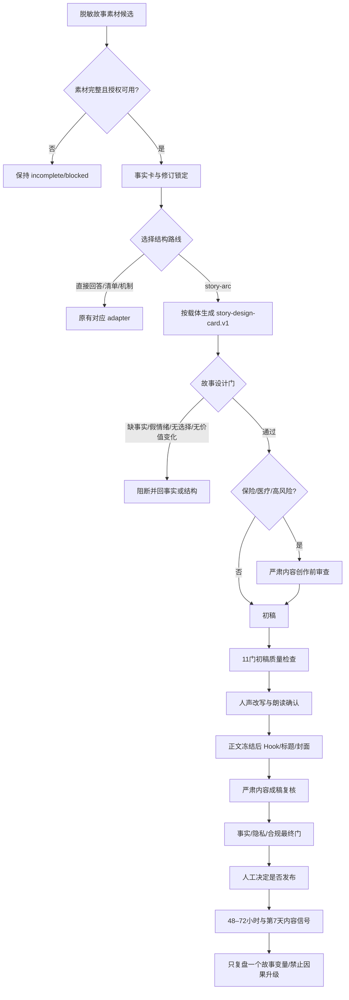

# 故事结构与情绪共鸣：研究结论及流程落地

更新时间：2026-09-03 19:20:00
执行工具/模型：Codex (GPT-5.6 Sol)

## 结论

故事结构不等于按时间复述事实。最低成立条件是：人物有一个当下目标，触发事件打破原状，现实与预期出现缺口，压力迫使人物选择，转折改变事情的意义或价值状态，结尾形成一个新状态并保留真实的不确定性。

情绪共鸣也不是在稿子里写“焦虑、感动、温暖”。它来自观众对事件意义的判断：这件事和我有什么关系；这个人面对了什么限制；他做了什么选择；付出了什么代价；结果发生了什么变化。情绪必须落到可观察动作、已确认原话或作者自己的反应，不能由模型补写客户内心。

## 本地书籍研究的吸收边界

本轮通过本地 `ebook_markdown_pipeline` 将用户提供的两套罗伯特·麦基作品转成可检索 Markdown，仅提炼结构概念，不复制原文：

- 结构是对事件的选择和安排，事件要表达意义并激发体验；
- 欲望、阻力、预期与结果的裂缝、转折、危机、高潮和结局共同形成故事脊柱；
- 人物通过压力下的选择被认识，而不是靠作者贴标签；
- 事实研究只有被转化为事件和选择才成为故事，一堆信息仍然只是资料；
- 具体个人经验中可识别的共同处境，有助于观众代入；
- 对白是行动，潜台词不应在下一句被旁白全部解释。

没有照搬电影三幕式、页码公式或不断升级冲突的要求。朋友圈、图文和短视频可以是“小故事”，但必须有因果变化；没有变化时应走直接回答、机制解释或工具清单路线。

## 外部研究的交叉验证

- Van Laer 等人的叙事运输元分析表明，故事质量、形象化和角色相关因素会影响叙事运输：[Journal of Consumer Research](https://academic.oup.com/jcr/article-abstract/40/5/797/2907487)。
- Oschatz 与 Marker 的元分析发现，叙事相较非叙事具有小但显著的持续说服优势，叙事运输与即时效果有关；这不是“故事一定更有效”的保证：[Journal of Communication](https://academic.oup.com/joc/article/70/4/473/5880130)。
- 健康传播研究把兴趣、认同和沉浸视为连续但不同的参与状态；过程故事、经历故事和结果故事承担不同任务：[Narrative Immersion Model](https://pmc.ncbi.nlm.nih.gov/articles/PMC6369912/)。
- 健康叙事通常需要人物、相互关联的事件、冲突或未决问题以及解决，但不需要电影式大冲突：[Using Written Narratives in Public Health Practice](https://pmc.ncbi.nlm.nih.gov/articles/PMC4049201/)。
- 叙事也可能让单一个案格外鲜明，从而造成启发式偏差或影响医疗选择，因此个案必须与一般证据、限制条件分开：[Personal stories in decision aids](https://pmc.ncbi.nlm.nih.gov/articles/PMC4044102/)。
- YouTube 官方把表现拆成吸引、参与和满意；开头应立即兑现标题封面的承诺，后段高留存信息可前移：[内容表现指南](https://support.google.com/youtube/answer/16559650?hl=en)、[观众留存说明](https://support.google.com/youtube/answer/9314415?hl=en)。

## 现行流程

## story-design-card 的关键字段

- `protagonist.immediate_goal`：人物现在要解决什么；
- `expectation_gap`：预期与现实的裂缝；
- `pressure`：真正限制选择的力量；
- `choice_under_pressure`：至少两个真实选项、实际行动和代价；
- `story_source`：来源模式、授权、身份和引语处理；
- `story_category`：起源、失败、客户转变、原则、方法诞生或普通案例时刻；
- `format_design`：每条独立成立，并按载体控制中心变化与转折数量；
- `scene_anchor`：可观察、可核验的场景锚点；
- `attempt_and_feedback`：第一次行动、预期反馈和真实反馈；
- `turning_points`：发生信息或价值变化；朋友圈与短视频为 1–3 个，其他载体使用各自上限；
- `climax`：最有意义的行动或揭示，不是口号；
- `resolution`：新状态及仍未知的部分；
- `audience_bridge`：受众共鸣依据是证据、作者观察还是待验证假设；
- `emotion_beats`：情绪目标必须绑定事件与证据；
- `explanation_bridge`：故事结束后用 2–4 句说明结论和边界，并声明个案不是总体证明。
- `editorial_diagnostics`：因果连接、SUCCESs 和记叙删减仅提供诊断警告，不能抵消事实或授权缺口；
- `publication_learning_plan`：发布前只选一个观察变量，绑定 48–72 小时和第 7 天窗口，结果只属于内容信号，不能直接推断因果或升级为客户结论。

## 与“故事揭示型”两秒门的兼容

故事可以晚一点给出中心判断，但不能晚一点给出观看理由。短视频在两秒内先展示具体结果片段、数字、选择冲突、关键问题或决定性场景；正文再解释它为何发生；中心判断在故事接近收尾时浮现；最后补短解释和边界。这样保留悬念，但不制造空悬念。

## 变更依据

- 意图：补齐原 Storycraft 对因果、转折和情绪证据检查不足的问题。
- 决策：新增条件式 `story-design-card.v1` 与确定性门禁，只在 `story-arc` 路线触发。
- 理由：故事是内容结构，不应成为所有内容的默认模板；医疗保险故事还需防止个案替代证据和情绪过度放大。
- 证据：本地麦基作品提炼、上述叙事与健康传播研究、现有严肃内容和事实合规门。
- 生效范围：新写或实质重写的故事型朋友圈、图文、口播、采访和案例内容。
- 回滚：同时回滚 Schema、检查器、fixture、测试、路由字段和 Skill 引用；不得只保留一半合同。

## 更新记录

### 2026-09-03 19:20:00 | Codex (GPT-5.6 Sol)

- 补入脱敏故事素材候选、来源与授权、场景锚点、行动—反馈、载体差异、软性创作诊断和单变量发布学习计划，使文档与 registered-content-routing 1.5.0 及当前执行代码一致。
