# 证据型综合稿到图文交付工作流

> 状态：可执行的人工研究与创作合同；不自动发布、不自动互动、不绕过平台风控。
> 更新时间：2026-08-27 10:34:17
> 执行者：Codex（GPT-5.6 Sol）

## 结论

最终图文统一接入“信息图、图文创作”已经验证的内容对象与渲染流程。平台刷帖、网页抓取和同行文章拆解只是上游证据生产，不另建内容状态机，也不把抓到的文章直接切页发布。

```mermaid
flowchart LR
    Q["真实问题 / 研究问题"] --> D["发现层：同行帖子与可见评论"]
    D --> C["问题聚类：反复疑问、遗漏、矛盾"]
    C --> T["任务与结构分流：内容任务 / 可选结构路线 / 问答是否重构"]
    T --> L["主张台账：candidate / conflicted / unknown"]
    L --> A["权威核验：监管、条款、保险公司或平台官方"]
    A --> S["证据型综合母稿：自己的结构与语言"]
    S --> O["唯一 content-item：provenance + draft + visual brief"]
    O --> F["graphic-note 格式适配器"]
    F --> P["小红书等平台 overlay"]
    P --> R["渲染路由：HTML/Playwright、Lieflat、ECharts、Mermaid、PptxGenJS"]
    R --> G["事实、隐私、版权、声纹、可读性质量门"]
    G --> H["人工审阅与手动发布"]
```



## 工具分工

2026-11-02｜Codex（GPT-6）：采集执行统一接入[平台采集、网页复用与恢复操作卡](docs/research-capture-execution.md)和现有 `self_media_agent.py research-capture` 入口。按平台分阶段落盘，连接30秒止损；全文、元数据、图页、字幕分别验收。下表是工具职责，实际可用性须当次验证；8月的 doctor 记录只作历史证据。

| 工具/流程 | 最适合做什么 | 不应做什么 |
|---|---|---|
| `agent-reach` / OpenCLI | 按关键词搜索小红书，读取可见笔记与评论，快速发现真实问法和分歧 | 把帖子当官方事实；高频批量抓取；点赞、评论、关注或绕过风控 |
| `wechat-tools` 手动信息流 | 用户实际浏览时，本地记录稳定可见内容；适合精读、人工挑样和导出脱敏 `content-bundle.v1` | 自动滚动信息流、私有 API、Cookie 提取、自动发布 |
| `web-content-fetcher` | 获取普通网页、监管/保险公司公开页面、附件与文档，保存抓取与归档证据 | 充当小红书搜索器；绕过登录、验证码、付费墙；替代事实判断 |
| Codex 证据综合 | 聚类问题、建立矛盾表和主张台账，只让核验后的结论进入母稿 | 拼接原文、复制图片/比喻、凭样本数量宣称“行业共识” |
| 统一图文流程 / Content Studio | 将稳定母稿拆成卡片任务，选择渲染器并生成可审阅成品 | 在排版阶段补造事实；所有主题套一个视觉皮肤 |

2026-08-03 检查：`agent-reach doctor --json` 显示小红书当前后端为 OpenCLI。该状态属于易变信息，每次正式采集前重查；登录、验证码或风险提示出现时停止，由用户处理。

## 最快且不牺牲质量的两轮研究

### 大主题尚未确定具体题目时：先做窄入口初筛

下面的“同一问题 3—5 组搜索表达”适用于已经有具体问题的研究，不应机械套到尚未确定题目的大主题上。

当前商业医疗险专项先按 [商业医疗险大主题选题发现操作卡](./商业医疗险大主题选题发现操作卡.md) 执行：只搜索少量核心词，以及真实账单、理赔和用户经历；然后在结果中筛选高购买意向、独立提问和真实情境。具体问题确认以后，才进入本工作流后面的扩展搜索与证据核验。

### 第一轮：只做发现，不急着写结论

围绕同一问题建立 3—5 组搜索表达：用户原话、通俗说法、专业词、反方问法、具体场景。只记录：

- 大家实际怎么问；
- 哪些问题反复出现；
- 现有回答遗漏了什么前提；
- 哪些说法互相冲突；
- 哪些词值得继续查官方来源。

连续两批样本不再出现新的问题类型时即可停止扩样。不要为了“完整”无限刷帖。

发现层结束后，先确定 `content_job`，再按 [内容结构路线库与人工改道规则](./structure-route-playbook.md) 选择本篇是否需要一条主 `structure_route`。问答题另按 [问答选题分流与条件式重构操作卡](./topic-reframing-playbook.md) 判断原问题能否直接回答：只有原问混淆对象、遗漏关键前提或简单是/否会误导时，才保留原问作为入口并重构到客户决定。深层法规、合同和例外是否进入前台，由目标受众和本篇任务决定。

### 第二轮：只核验会进入成稿的主张

为每个拟写结论建立主张台账：

| 字段 | 含义 |
|---|---|
| `claim_id` | 稳定编号 |
| `audience_question` | 用户实际疑问 |
| `structure_route` | 本篇可选展开路线；不是所有研究题都必填 |
| `structure_route_note` | 选择理由；人工改道时记录变化与原因 |
| `question_structure_route` | `direct-answer` / `decision-reframe` / `not-applicable` |
| `audience_entry_question` | 用户会搜索、点击的流量入口 |
| `professional_core_question` | 仅 `decision-reframe`：真正需要回答的问题 |
| `client_decision` | 仅 `decision-reframe`：读者最终要完成的判断或动作 |
| `candidate_claim` | 从同行内容发现的候选说法 |
| `discovery_refs` | 帖子/评论引用，只能支持“有人这样问或这样说” |
| `authority_needed` | 需要哪类一手来源 |
| `authority_refs` | 监管、条款、保险公司或平台官方证据 |
| `status` | `candidate` / `conflicted` / `verified` / `rejected` / `unknown` |
| `scope_and_date` | 适用范围与核验日期 |
| `quantitative_scope` | 仅量化主张：地区、时期、人群、事件、时间窗、统计类型、分母、数值性质 |
| `supports` | 这项证据实际回答什么问题 |
| `does_not_support` | 不能从这项证据推出什么 |
| `derivation_and_assumptions` | 仅反推值：公式、分母一致等假设；直接统计可空 |
| `usage_status` | `active` / `supporting` / `background` / `retired`；与真假状态分开 |
| `reuse_mode` | `direct-crop` / `redraw` / `quote-only` / `link-only` / `not-for-publication` |
| `final_wording` | 用本人语言写出的可发布表述 |

只有 `verified` 可以作为事实结论；`conflicted` 和 `unknown` 必须在正文中显式保留边界，或从成稿删除。

量化主张还要通过“数据是否回答当前问题”检查：比例不能自动代替最终金额，平均数不能自动代替高费用尾部，个案不能自动代替发生频率，反推值不能写成官方直接统计。家庭承受力测试标为 `scenario-stress-test`，只帮助读者代入自己的财务边界，不冒充疾病费用预测或统一准备金额。

`retired` 表示证据退出当前版本，不表示来源为假。被更强证据替换、与正文决策不再匹配或因版权限制退出的材料，保留退出原因并禁止继续进入标题、正文和视觉。截图、裁切和重绘方式在母稿稳定前确定，不能等制图完成后再补版权判断。

## 如何回到唯一内容对象

不新增平行稿件对象。研究完成后建立或更新现有 `content-item`：

- `operating_plan.origin_kind = research-synthesis`；
- 同行帖子、评论、搜索结果放入 `provenance.sources`，类型记为 `candidate-evidence`；
- 监管、条款、保险公司或平台官方页面记为 `official-web`；
- `verified_facts` 只写主张台账中已核验的结论；
- `uncertainties` 保存冲突、时效和适用范围；
- `forbidden_claims` 保存标题不能超过的边界；
- 母稿、平台稿、视觉 Brief、发布冻结版仍属于同一个内容 ID。

内容对象只保存必要的短摘记、问题标签、主张和来源引用。已获授权取得的全文、图页和来源证据留在既有私有研究归档，供完整性复查，不混入公开稿件；不未经许可复用原图，不把对方独特比喻、标题或结构细节当作自己的资产。2026-11-02 18:12:02 +08:00｜Codex（GPT-6）：明确研究归档与公开复用的不同边界。

## 最终图文路由

1. 母稿稳定后才进入 `graphic-note` adapter：一页一个认知任务，正文 caption 补背景、边界和来源，不与图片逐字重复。
2. 再叠加平台 overlay：例如小红书强调可搜索的问题、明确封面承诺与收藏用途，但不改变事实结论。
3. 按内容任务选渲染器：
   - 普通知识卡、案例过程、决策卡：默认 `HTML/CSS + Playwright`；
   - 真实数据叙事：`Lieflat Charts`；
   - 精确坐标、交互或多序列图：`ECharts`；
   - 流程、结构、关系：`Mermaid`；
   - 需要用户后续编辑：`PptxGenJS`；
   - 可编辑矢量备份：SVG，但不作为中文复杂排版的默认终稿。
4. 视觉风格跟主题、受众、阅读任务和使用情境走，不按账号固定换色。
5. 最终执行事实、隐私、医疗保险、版权、声纹、可读性与标题兑现检查，再交给用户手动发布。

## 最小路由回执

```yaml
route_id: route-YYYYMMDD-topic
task_type: research
origin_kind: research-synthesis
account_ip: cange-risk-diagnosis | cange-growth | dual-account-shared
primary_audience: 本篇首先帮助谁
primary_goal: understanding | save-for-later | trust | discussion
structure_route: direct-answer | decision-reframe | scenario-branch | gap-diagnosis | tradeoff-comparison | case-review | mechanism-explanation | tool-action | boundary-map | story-arc | opinion-argument | custom
structure_route_note: 为什么此路线适合本篇；可由人工中途改写
format: graphic-note
platform: xiaohongshu
research_packet_ref: 本地主张台账或证据包
discovery_tools: [agent-reach, wechat-tools-manual-feed]
authority_tools: [web-content-fetcher, official-source-review]
format_adapter_id: graphic-note
platform_overlay_id: xiaohongshu
renderer: html-playwright | lieflat-charts | echarts | mermaid | pptxgenjs
quality_gates: [fact, privacy, medical_insurance, rights, voice, accessibility]
publication: manual-only
```

## 与两个既有任务的关系

- `可见内容采集与脱敏工具` 提供的是“可见内容采集、脱敏导出和离线诊断”能力，不是事实权威，也不是最终制图器。
- `ContentStudio` 提供的是最终“内容对象、图文拆页、视觉路由、渲染和质量门”流程，应作为图文交付终点。

## 变更依据

- 意图：把平台内容发现、官方核验、综合写作与最终图文交付接成一条可复用链路。
- 决策：复用现有 `content-item`、格式 adapter、平台 overlay 与 Content Studio；新增的只是研究阶段合同。
- 理由：采集工具、事实工具、写作工具和制图工具的证据权限不同，混用会把同行观点误写成事实，也容易造成版权性拼接。
- 证据：现有 `wechat-tools` 已支持只读手动信息流和脱敏导出；本系统已有 `research-synthesis` 来源类型、图文 adapter 与质量门；信息图任务已验证多渲染器路线。
- 生效范围：研究型文章、问答、产品比较、案例科普及其小红书/公众号/视频图文改写；不扩大自动发布、客户联系或平台互动权限。
- 回滚：删除本文件并撤销 `task-router.json`、`skill-registry.json`、`quality-gates.json`、路由卡、运行册和索引中的对应增量即可；不影响现有内容对象或经营 Schema。

## 2026-08-20 12:52:09 +08:00 | Codex (GPT-5.6 Sol)

- 意图：同步登记主链的量化证据口径、用途状态和截图权利前置规则，同时保持两套路由合同隔离。
- 决策：只扩展本仓研究主张台账和质量门语义，不复制登记路由 JSON，不新增生命周期对象。
- 理由：本仓已经承担平台发现与证据综合；把“回答什么／不能回答什么”放在研究阶段，能在写稿前淘汰口径不匹配的数据。
- 证据：普通医保第二版的证据替换、压力测试标注和医疗费用截图清单。
- 生效范围：含量化主张、证据替换或研究截图的证据型综合稿。
